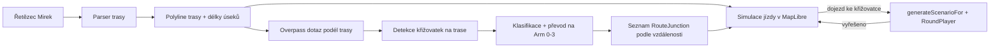

# Analýza: jízda po trase na mapě (MapLibre + OSM)

## Cíl

Nový herní režim **Jízda po trase**:

1. Načtu trasu ve formátu Mirek (řetězec souřadnic lon/lat), start a cíl.
2. Trasa se zobrazí na mapě v MapLibre a auto po ní jede (simulace).
3. Z dat OpenStreetMap se předem zjistí, kterými křižovatkami trasa projíždí.
4. Když auto dojede ke křižovatce, zastaví a nabídne se **přesně taková křižovatka** k řešení
   (počet a směr ramen, řízení, hlavní silnice, tramvaj, přechody).
5. Naše auto přijíždí ve směru jízdy po trase a odbočuje tak, jak vede trasa. **Náš směr je pevný.**
6. Ostatní účastníci, fáze semaforu, kolony, sanitka apod. jsou **náhodné**. Při druhém průjezdu stejnou
   křižovatkou se vygeneruje nová situace.

## Co z existující hry zůstává

Pravidla v [src/rules.ts](src/rules.ts) pracují s abstraktním modelem (`Intersection` + `Vehicle[]` v
[src/types.ts](src/types.ts)):

- max. 4 ramena `Arm` 0–3 v pravých úhlech, hráč vždy přijíždí z ramene 0 (jih, zdola),
- typ řízení: rovnocenná, hlavní silnice (`mainArms`), semafory (`signals`), policista, kruhový objezd,
- tramvajová trať mezi dvěma rameny, přechody na ramenech.

Model ani pravidla se nemění. **Reálnou křižovatku z OSM je potřeba převést na tento model** a
generátoru předat pevnou křižovatku a pevný směr hráče. Zbytek (`RoundPlayer`, vykreslení, vyhodnocení)
se použije beze změny.

Podmínka „naše auto v křižovatce po směru jízdy“ se tím splní automaticky: hra kreslí hráče vždy zdola,
takže schéma je natočené po směru jízdy. Mapu je vhodné natáčet stejně (`map.setBearing(kurz auta)`),
aby přechod mapa → schéma působil plynule.

## Architektura



Navrhované nové moduly (adresář `src/route/`):

| Soubor           | Obsah                                                                    |
| ---------------- | ------------------------------------------------------------------------ |
| `mirek.ts`       | dekodér formátu Mirek → `[lon, lat][]` (hotovo)                           |
| `route.ts`       | `createRoute(pole bodů \| Mirek)` → body, vzdálenosti, délka (hotovo)     |
| `geo.ts`         | vzdálenost (haversine), azimut, bod na trase ve vzdálenosti, projekce    |
| `osm.ts`         | sestavení Overpass dotazu, stažení, cache, převod na graf uzlů a cest    |
| `junctions.ts`   | nalezení křižovatek na trase, shlukování, klasifikace, mapování na `Arm` |
| `drive.ts`       | simulace pohybu auta po trase, spouštění křižovatek                      |
| `mapView.ts`     | MapLibre: podklad, trasa, auto, značky křižovatek, kamera                |

Úpravy stávajícího kódu:

- [src/generator.ts](src/generator.ts) – nová funkce `generateScenarioFor(fixed, playerTo, seed)`; dnes se
  křižovatka i směr hráče losují v `buildIntersection` / `buildVehicles`.
- [src/main.ts](src/main.ts) – nový režim v menu, přepínání mapa ↔ křižovatka.
- [src/storage.ts](src/storage.ts) – případně statistiky po trasách.

## 1. Trasa (formát Mirek)

- Formát Mirek = `coordsToString` / `stringToCoords` z `@mapy/mapy-utils` (privátní registry, proto je
  dekodér převzatý do [src/route/mirek.ts](src/route/mirek.ts)): vlastní 64znaková abeceda, 6 bitů na
  znak, střídavě lon/lat kvantované na 28 bitů, delta kódování (2 nebo 3 znaky), absolutní hodnota
  5 znaků. Nese jen body – start = první bod, cíl = poslední.
- Vstup [createRoute](src/route/route.ts): pole bodů `[lon, lat]` nebo řetězec Mirek.
- Výstup: pole bodů `[lon, lat]` (bez opakovaných bodů), kumulativní vzdálenosti bodů od startu (m),
  celková délka.
- Pozor na pořadí lon/lat (GeoJSON i MapLibre používají `[lon, lat]`, Overpass `lat,lon`).
- Pokud trasa obsahuje velmi husté body, zjednodušit (Douglas–Peucker, tolerance ~2 m) – kvůli výkonu
  i délce Overpass dotazu.

## 2. Data z OpenStreetMap

### Zdroj

**Overpass API** (CORS je povolený, lze volat z prohlížeče). Jeden dotaz na celou trasu – koridor kolem
polyline:

```
[out:json][timeout:60];
(
  way(around:40,{lat1},{lon1},{lat2},{lon2},...)["highway"~"^(motorway|trunk|primary|secondary|tertiary|unclassified|residential|living_street|service)(_link)?$"];
  way(around:40,{lat1},{lon1},...)["railway"="tram"];
);
(._;>;);
out body;
```

- `around` se seznamem souřadnic tvoří koridor podél lomené čáry.
- Dlouhé trasy rozdělit na úseky (např. po 200 bodech) – limit délky dotazu a timeout.
- Výsledek cachovat (IndexedDB / `localStorage` podle velikosti) klíčem = hash trasy; respektovat
  pravidla používání veřejné instance Overpass.
- Alternativa pro pevné trasy (autoškola): předzpracování skriptem v `scripts/` → statický JSON v buildu,
  hra pak OSM vůbec nevolá.

### Použité značky (tagy)

| Účel                     | OSM tag                                                                                   |
| ------------------------ | ----------------------------------------------------------------------------------------- |
| sjízdné silnice          | `highway=*` (viz dotaz), bez `service=driveway/parking_aisle`, bez `access=no/private`    |
| jednosměrky              | `oneway=yes/-1`, `junction=roundabout` (implicitně jednosměrný)                           |
| semafory                 | uzel `highway=traffic_signals` v křižovatce nebo do ~30 m na rameni                        |
| přechod se semaforem     | `highway=crossing` + `crossing=traffic_signals` – **není** řízení křižovatky              |
| Dej přednost / STOP      | uzel `highway=give_way` / `highway=stop` (+ `direction=forward/backward`) na rameni        |
| hlavní silnice           | `priority_road=designated` na cestě (v ČR se používá), jinak odhad podle třídy silnice     |
| kruhový objezd           | `junction=roundabout` (příp. `junction=circular`)                                          |
| tramvaj                  | `railway=tram` sdílející uzel s křižovatkou                                               |
| přechod pro chodce       | uzel `highway=crossing` na rameni do ~25 m od středu                                       |
| název ulice              | `name` – pro popisek „Masarykova × Husova“                                                |

## 3. Detekce křižovatek na trase

1. **Graf:** uzel je kandidát na křižovatku, pokud ho sdílí ≥ 2 sjízdné cesty nebo je uvnitř jedné cesty
   a má stupeň ≥ 3. Mosty/tunely uzly nesdílí, takže se křížení v různých úrovních nezapočítá samo.
2. **Shlukování:** uzly do ~25 m od sebe sloučit do jedné křižovatky (dvoupruhové silnice s dělicím
   pásem, odbočovací pruhy `*_link`, kruhový objezd = všechny uzly prstence).
3. **Leží na trase?** Vzdálenost středu shluku od polyline < ~12 m **a** azimut trasy před a za bodem
   odpovídá některému rameni (odchylka < 35°). Tím se vyřadí rovnoběžné ulice a křižovatky „vedle“ trasy.
4. **Ramena:** pro každou cestu vycházející ze shluku azimut ze středu k bodu ~20 m po cestě (ne k
   nejbližšímu uzlu – ten bývá 1 m daleko a azimut je nepřesný). Ramena s rozdílem azimutu < 20 °
   sloučit.
5. **Vjezd a výjezd hráče:** rameno nejbližší azimutu trasy ~20 m před křižovatkou (obráceně) = vjezd,
   rameno nejbližší azimutu ~20 m za ní = výjezd.
6. **Pozice na trase:** vzdálenost průmětu středu od startu → seznam křižovatek seřazený podle
   vzdálenosti. Smyčka na trase = stejná křižovatka v seznamu dvakrát (každý průjezd zvlášť).
7. **Filtr:** jen 3–4 ramena po převodu (viz níže), vynechat napojení na parkoviště, sjezdy z dálnic,
   „křižovatky“ s polní cestou apod.

## 4. Převod reálné křižovatky na model hry

### Ramena → `Arm`

Hráčův vjezd je vždy rameno 0. Pro každé další rameno relativní úhel měřený po směru hodinových ručiček
od ramene vjezdu:

$$r = (\beta_{rameno} - \beta_{vjezd} + 360) \bmod 360$$

| $r$       | Arm | Pro hráče    |
| --------- | --- | ------------ |
| 45–135°   | 3   | vlevo (západ)|
| 135–225°  | 2   | rovně (sever)|
| 225–315°  | 1   | vpravo (východ) |

Tj. `arm = (4 - round(r / 90)) % 4`. Když dvě ramena padnou do stejného kvadrantu, zvolit přiřazení
s nejmenším součtem odchylek (max. 4! permutací). Křižovatky s > 4 rameny nebo s odchylkou > ~50 °
přeskočit (nebo označit „nestandardní“ a nenabízet).

### Řízení

Postup podle priority:

1. ramena v prstenci `junction=roundabout` → `roundabout`, `yieldOnEntry` = `true` (v ČR je výchozí
   stav, `false` jen pokud je na vjezdech výslovně chybějící `give_way` – v datech těžko odlišitelné,
   proto default `true`),
2. `highway=traffic_signals` v křižovatce → `signals` (fáze semaforu OSM nezná → **losují se**, jako dnes),
   `blinking` volitelně náhodně,
3. `give_way` / `stop` na některých ramenech → ta ramena vedlejší, ostatní (dvojice) = `mainArms`;
   rovná/lomená hlavní podle úhlu mezi hlavními rameny,
4. `priority_road=designated` na dvou ramenech → `mainArms`,
5. jinak odhad: dvě ramena s výrazně vyšší třídou silnice (např. `secondary` vs. `residential`) = hlavní;
   všechna ramena stejné třídy (obytná zóna, `residential`) = rovnocenná,
6. nejisté případy označit `confidence: 'low'` a v UI zobrazit „podle dat OSM – nemusí odpovídat realitě“
   (nebo je nenabízet – viz otevřené otázky).

Policista z OSM nikdy nevyplyne – v tomto režimu se nepoužije.

### Ostatní

- `tramLine`: dvojice ramen, mezi kterými vede `railway=tram` přes shluk.
- `crosswalks`: ramena s `highway=crossing` do ~25 m.
- `label`: názvy ulic z `name`.
- `yieldSign`: `stop` / `giveWay` podle uzlu na rameni.

## 5. Generování situace (pevná křižovatka, pevný směr)

Nová funkce v generátoru, zhruba:

```ts
interface FixedJunction {
  intersection: Omit<Intersection, 'signals'> & { hasSignals: boolean };
  playerTo: Arm;
  /** Ramena, ze kterých nelze přijet (jednosměrky). */
  noEntry: Arm[];
}

export function generateScenarioFor(fixed: FixedJunction, seed: number): Scenario;
```

- `buildIntersection` se nahradí kopií pevné křižovatky; náhodně se doplní jen plán semaforu.
- V `buildVehicles` je hráč `from: 0, to: fixed.playerTo` (dnes `pickExit`), ostatní vozidla jen z ramen
  mimo `noEntry` a jen na ramena, kam lze vjet.
- Tramvaj jen pokud OSM tramvaj má (a jede po své trati, ne náhodně).
- Kolona / sanitka / chodec náhodně jako dnes (`allowedExtras`).
- Smyčka pokusů s `isSolvable` apod. zůstává; pokud se nepodaří, zjednodušit (bez extras, méně vozidel).
  Pevná křižovatka se nemění nikdy.
- **Seed:** `deriveSeed(sessionSeed, junctionIndex * 1000 + passIndex)` – každý průjezd jiná situace,
  ale celá jízda je reprodukovatelná (sdílení odkazem jako u testu).

Jednosměrky nejsou v dnešním modelu – přidat do `Intersection` volitelné `noEntry?: Arm[]` (vliv jen na
generátor, pravidla zůstanou). Případně ve v1 jednosměrky jen vyloučit z vjezdů ostatních vozidel.

## 6. Mapa a simulace jízdy

- **MapLibre GL JS** (`maplibre-gl`) načíst dynamickým importem (samostatný webpack chunk, ~800 kB),
  aby se základní hra nezvětšila.
- **Podklad:** vektorový styl – OpenFreeMap (bez klíče), MapTiler (klíč) nebo Mapy.cz (klíč, rastrové
  dlaždice). Atribuce © OpenStreetMap povinná.
- Vrstvy: trasa (`line`), projeté části jinou barvou, značky křižovatek (barva podle typu), auto
  (symbol/HTML marker natočený podle kurzu).
- **Simulace:** `requestAnimationFrame`, rychlost nastavitelná (např. 50 km/h × zrychlení 1–10×),
  pozice = bod na polyline ve vzdálenosti `s`, kurz = azimut aktuálního úseku (vyhladit).
- Kamera sleduje auto, `bearing` = kurz, `pitch` ~45° pro pohled „za autem“.
- **Spouštění:** ~40 m před křižovatkou zpomalit, ~15 m před ní zastavit a otevřít panel s křižovatkou
  (stávající SVG scéna + `RoundPlayer`). Po vyřešení pokračovat. Možnost „přeskočit“.
- Na konci trasy souhrn: počet křižovatek, správně/špatně, seznam s možností přehrání (jako po testu).

### Varianta: skutečná jízda s GPS

Polohu lze brát z `navigator.geolocation.watchPosition` místo simulace (stejná logika spouštění, průmět
polohy na trasu). **Jen pro spolujezdce** – řidič nesmí za jízdy hrát; v UI výrazné upozornění. Vyžaduje
HTTPS (produkční web ho má).

## 7. Grafika křižovatky

- **v1:** stávající ortogonální schéma (ramena v pravých úhlech) + malý výřez mapy se skutečným tvarem
  a šipkou trasy, aby bylo vidět, o kterou křižovatku jde.
- **v2 (volitelně):** vykreslovat ramena ve skutečných úhlech – vyžaduje úpravy
  [src/geometry.ts](src/geometry.ts) a [src/render.ts](src/render.ts) (trajektorie, pozice značek,
  semaforů). Pravidla tím nejsou dotčena, pokud zůstane pořadí ramen.

## 8. Rizika a omezení

- **Neúplná data OSM:** značky Dej přednost / STOP v ČR často chybí → hlavní silnice se odhaduje.
  Chybné zadání = chybné „správné“ řešení. Zmírnit: příznak `confidence`, zobrazit zdroj, možnost
  nahlásit / ručně opravit křižovatku (uložit opravu k trase).
- **Složité křižovatky:** víc než 4 ramena, šikmá ramena, odbočovací pruhy, dvojité křižovatky blízko
  sebe, mimoúrovňové sjezdy – v1 přeskočit.
- **Semafory:** fáze ani šipky z OSM nejsou → losují se; neodpovídají skutečné křižovatce.
- **Overpass:** limity a výpadky veřejné instance → cache, retry, případně předzpracování skriptem.
- **Přesnost trasy:** pokud trasa není „přichycená“ na OSM silnice, může minout uzel o desítky metrů →
  tolerance + kontrola azimutů; u velké odchylky křižovatku vynechat.
- **Velikost buildu:** MapLibre jen v lazy chunku.

## 9. Testy

- parser Mirek (vzorové řetězce),
- `geo.ts` (vzdálenost, azimut, bod na trase),
- mapování ramen na `Arm` (T, X, šikmé, kolize kvadrantů, > 4 ramena),
- detekce a klasifikace nad uloženými odpověďmi Overpass (`tests/fixtures/*.json`) – bez sítě,
- `generateScenarioFor`: hráč má vždy zadaný směr, křižovatka se nemění, různé seedy = různé situace,
  vždy řešitelné.

## 10. Postup (milníky)

1. **Trasa + mapa:** parser Mirek, MapLibre, vykreslení trasy, simulace jízdy auta s kamerou.
2. **OSM + detekce:** Overpass, detekce křižovatek na trase, ladicí vrstva na mapě (značka + popis
   klasifikace u každé křižovatky) – ověřit na několika reálných trasách.
3. **Převod na model:** mapování ramen, řízení, `generateScenarioFor`, testy.
4. **Napojení na hru:** nový režim v menu, zastavení u křižovatky, `RoundPlayer`, souhrn na konci.
5. **Vylepšení:** jednosměrky, cache / předzpracování skriptem, GPS režim, skutečné úhly ramen.

## Otevřené otázky

1. ~~Přesný formát Mirek~~ – vyřešeno, viz kap. 1.
2. Simulace na mapě, nebo i skutečná jízda s GPS?
3. Zdroj mapových podkladů (OpenFreeMap bez klíče / MapTiler / Mapy.cz s klíčem)?
4. Nabízet všechny křižovatky na trase, nebo jen některé (např. kde hráč musí dávat přednost, každou
   n-tou, minimální třída silnice)?
5. Co s křižovatkami, kde OSM neumožní spolehlivě určit přednost – přeskočit, nebo nabídnout s
   upozorněním?
6. Stačí ortogonální schéma, nebo jsou potřeba skutečné úhly ramen?
7. Typická délka trasy (kvůli Overpass dotazům a cache)?
8. Má jít trasu sdílet odkazem (seed + trasa v URL / uložená na serveru)?
